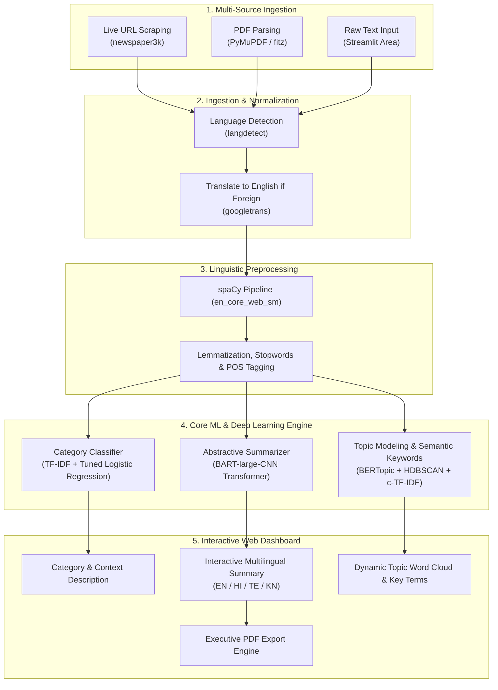

# NewsSense: AI-Powered News Intelligence & Summarization Platform

[](https://www.python.org/)
[](https://streamlit.io/)
[](https://huggingface.co/facebook/bart-large-cnn)
[](https://pytorch.org/)
[](https://scikit-learn.org/)
[](https://spacy.io/)
[](LICENSE)

An end-to-end Natural Language Processing (NLP) intelligence platform designed to ingest multi-source news articles, predict news categories, generate abstractive summaries with Transformers, discover latent topic clusters, translate summaries into regional Indian languages, and produce executive PDF briefs.

---

## 📌 Table of Contents
- [Executive Overview](#-executive-overview)
- [Key Features](#-key-features)
- [System Architecture](#-system-architecture)
- [Machine Learning & NLP Pipelines](#-machine-learning--nlp-pipelines)
- [Tech Stack](#-tech-stack)
- [Project Structure](#-project-structure)
- [Getting Started](#-getting-started)
- [Engineering Highlights & Optimizations](#-engineering-highlights--optimizations)
- [Author & Connect](#-author--connect)

---

## 🚀 Executive Overview

In the era of high-velocity digital media, digesting long-form journalism across multiple channels is time-intensive and noisy. **NewsSense** addresses this challenge through an automated NLP pipeline that combines **statistical machine learning**, **deep transformer models**, and **semantic topic modeling**:

1. **Multi-Source Ingestion**: Ingests articles directly via live URLs, uploaded PDF documents, or raw text input.
2. **Language Normalization**: Automatically detects foreign language text and translates it to English before analysis.
3. **Supervised Classification**: Categorizes content into 5 news verticals (`Business`, `Entertainment`, `Politics`, `Sport`, `Tech`) with low-confidence failover to `Others`.
4. **Abstractive Summarization**: Uses a 406M-parameter Sequence-to-Sequence BART transformer to generate coherent, executive-level summaries.
5. **Semantic Topic Modeling**: Extracts semantic keywords and clustering weights using **BERTopic** + **spaCy** Part-of-Speech tagging.
6. **Regional Accessibility**: Translates summaries in real-time into regional Indian languages (**Hindi**, **Telugu**, **Kannada**).
7. **Document Export**: Dynamically compiles and exports executive PDF briefs with custom Unicode font rendering.

---

## ✨ Key Features

| Capability | Engineering Implementation |
| :--- | :--- |
| **Multi-Source Ingestion** | • **Live URL**: Automated article scraping with `newspaper3k`.<br>• **PDF Upload**: In-memory text stream extraction via `PyMuPDF` (`fitz`).<br>• **Raw Text**: Direct copy-paste interface for custom input. |
| **Language Normalization** | Uses `langdetect` for ISO language identification. Non-English articles are automatically routed through `googletrans` prior to NLP inference. |
| **Category Classification** | Trained on the BBC News dataset with **TF-IDF Vectorization** (10,000 sublinear n-grams, range 1–3) and **Logistic Regression** tuned via 5-fold `GridSearchCV` (`f1_macro` optimization). Automatically flags low-confidence predictions ($< 30\%$) as `Others`. |
| **Abstractive Summarization** | Powered by **`facebook/bart-large-cnn`** (406M parameters). Produces fluent, grammatically sound, abstractive summaries rather than simple extractive sentence selection. |
| **Dynamic Semantic Keywords** | Combines **BERTopic** semantic cluster representations with **spaCy** Part-of-Speech (`NOUN`, `PROPN`, `ADJ`) extraction. Filters out domain-specific journalistic noise (`said`, `mr`, `spokesman`, `report`, `told`) to generate high-signal word clouds. |
| **Multilingual Translation** | One-click interactive UI toggling between English and regional Indian languages: **Hindi (`hi`)**, **Telugu (`te`)**, and **Kannada (`kn`)**. |
| **Executive PDF Export** | Generates downloadable executive reports formatted via `FPDF` with integrated Unicode font fallbacks (`DejaVu Sans` / `Arial` / `Segoe UI`) to safely handle currency symbols (e.g., `₹`), em-dashes, and smart quotes. |

---

## 🏗️ System Architecture



---

## 🧠 Machine Learning & NLP Pipelines

### 1. News Classification Model
- **Dataset**: BBC News multi-class corpus (`business`, `entertainment`, `politics`, `sport`, `tech`).
- **Feature Extraction**: `TfidfVectorizer` with `max_features=10000`, n-gram range `(1, 3)`, sublinear term frequency, and English stopword filtering.
- **Classifier**: `LogisticRegression` with balanced class weights and `liblinear` solver.
- **Hyperparameter Optimization**: 5-fold cross-validation with `GridSearchCV` maximizing `f1_macro` across inverse regularization parameters $C \in \{0.1, 1, 10\}$.
- **Confidence Guardrail**: If prediction confidence is $< 0.30$, the article is assigned to `others` to prevent hallucinations on out-of-domain text.

### 2. Abstractive Summarization Model
- **Model**: `facebook/bart-large-cnn` from Hugging Face Transformers.
- **Architecture**: Bidirectional Encoder + Autoregressive Decoder Seq2Seq model (406M parameters).
- **Inference Optimization**: Input text is bounded to 1,024 tokens to respect transformer positional encoding limits, preventing memory blowups and latency spikes.

### 3. Topic Modeling & Semantic Extraction
- **Clustering**: **BERTopic** leveraging `sentence-transformers` for contextual embeddings, **UMAP** for non-linear dimensionality reduction, and **HDBSCAN** for density-based clustering with noise tolerance (`-1`).
- **Semantic Fallback**: If an article falls into an outlier cluster (`-1`), the pipeline uses `topic_model.find_topics()` to assign it to the nearest semantic topic space.
- **Keyword Weighting**: Combines spaCy POS-filtered noun/adjective counts with BERTopic cluster c-TF-IDF keyword scores.

---

## 💻 Tech Stack

| Layer | Technologies |
| :--- | :--- |
| **Frontend & UI** | Streamlit, Custom CSS Styling, Matplotlib, WordCloud |
| **Deep Learning** | PyTorch, Hugging Face `transformers` (`bart-large-cnn`) |
| **Topic Modeling** | BERTopic, `sentence-transformers`, UMAP, HDBSCAN |
| **Classical ML** | Scikit-learn (`TfidfVectorizer`, `LogisticRegression`, `GridSearchCV`) |
| **NLP & Text Mining** | spaCy (`en_core_web_sm`), NLTK (`punkt`, `stopwords`) |
| **Ingestion & Parsers**| Newspaper3k, PyMuPDF (`fitz`), langdetect, googletrans |
| **Reporting & Export** | FPDF (with Unicode TrueType DejaVu/Arial font injection) |
| **Serialization** | Joblib |

---

## 📁 Project Structure

```text
NewsSense/
├── NewSense/
│   ├── App/
│   │   ├── app.py              # Main Streamlit web application & UI layouts
│   │   └── utils.py            # NLP utilities, scrapers, model pipelines & translation
│   ├── models/
│   │   ├── classifier.pkl      # Trained Logistic Regression classification weights
│   │   ├── tfidf_vectorizer.pkl# Serialized TF-IDF feature vectorizer
│   │   └── bertopic_model/     # Serialized BERTopic clustering model
│   ├── notebooks/
│   │   ├── train_classifier.py # Model training, preprocessing & GridSearchCV pipeline
│   │   ├── topic_modeling.py   # BERTopic model fitting script
│   │   └── bbc_news_text...csv # BBC news dataset used for model training
│   └── requirements.txt        # Pinned dependency manifest
├── .gitignore                  # Git ignore rules (virtual environments, caches, bundles)
└── README.md                   # Comprehensive project documentation
```

---

## ⚡ Getting Started

### 1. Clone the Repository
```bash
git clone https://github.com/Suchith29/NewsSense.git
cd NewsSense
```

### 2. Create and Activate a Virtual Environment
```bash
# Windows
python -m venv venv
.\venv\Scripts\activate

# Linux / macOS
python3 -m venv venv
source venv/bin/activate
```

### 3. Install Dependencies & spaCy Language Model
```bash
cd NewSense
pip install -r requirements.txt
python -m spacy download en_core_web_sm
```

### 4. Run the Streamlit Application
```bash
streamlit run App/app.py
```
Open your browser and navigate to: **`http://localhost:8501`**

---

## ⚙️ Engineering Highlights & Optimizations

- **Resource Caching**: Utilizes `@st.cache_resource` for loading heavy neural network weights (`BERTopic`, BART pipeline) so models stay resident in memory rather than reloading on every user interaction.
- **Journalistic Noise Filtration**: Standard NLP stopword lists miss common reporting tropes. NewsSense introduces an editorial stopword set (`said`, `mr`, `spokesman`, `told`, `report`) ensuring word clouds reflect true article semantics rather than reporting verbs.
- **Out-of-Domain Graceful Degradation**: Real-world news APIs frequently receive atypical or anomalous text; confidence score thresholding ($< 30\%$) prevents erroneous category tagging.
- **Robust Unicode PDF Generation**: Solves standard `fpdf` Latin-1 encoding crashes by dynamically detecting system TrueType fonts (`DejaVu Sans`, `Segoe UI`, `Arial`), seamlessly supporting Indian Rupee symbols (`₹`), directional quotes, and em-dashes.

---

## 👨‍💻 Author & Connect

**Suchith Reddy**  
- **GitHub**: [@Suchith29](https://github.com/Suchith29)  
- **Email**: `suchithreddymarri@gmail.com`  

---

## 📄 License
This project is open-source and licensed under the [MIT License](LICENSE).
