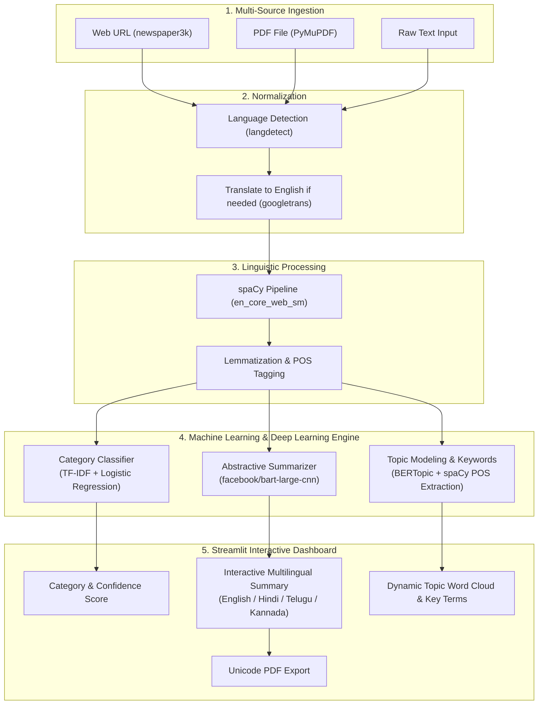

# 📰 NewsSense — AI-Powered News Analysis Platform

An end-to-end Natural Language Processing (NLP) intelligence platform that ingests news articles from multiple sources, predicts news categories, generates abstractive summaries using Transformers, extracts semantic keywords, dynamically translates summaries into regional Indian languages, and exports executive PDF briefs.

---

## 🌟 Key Features

* **Multi-Source Ingestion**:
  * 🌐 **Live Web URL**: Automatically scrapes headlines and article body using `newspaper3k`.
  * 📄 **PDF Document Upload**: Extracts text streams from uploaded PDF reports via `PyMuPDF` (`fitz`).
  * ✍️ **Raw Text Input**: Direct paste or manual entry for custom text analysis.
* **Automatic Language Detection & Normalization**:
  * Automatically detects language with `langdetect`.
  * Seamlessly routes non-English articles through Google Translate before NLP inference.
* **Supervised News Classification**:
  * Classifies articles into 5 domains: **Business**, **Entertainment**, **Politics**, **Sport**, and **Tech**.
  * Automatically assigns low-confidence predictions ($< 30\%$) to **"Others"**.
  * Trained on the BBC News dataset with **TF-IDF Vectorization** (10,000 n-grams) + **Logistic Regression** tuned with 5-fold `GridSearchCV`.
* **Abstractive Text Summarization**:
  * Powered by **`facebook/bart-large-cnn`** (a 406M parameter Sequence-to-Sequence Bidirectional & Autoregressive Transformer).
  * Generates fluent, human-like summaries rather than just extracting sentences.
* **Multilingual Summary Translation**:
  * Instant one-click UI toggle to translate the generated summary into:
    * 🇮🇳 **Hindi (`hi`)**
    * 🇮🇳 **Telugu (`te`)**
    * 🇮🇳 **Kannada (`kn`)**
* **Dynamic Topic Word Cloud & Key Terms**:
  * Combines **BERTopic** semantic clustering with **spaCy** Part-of-Speech (`NOUN`, `PROPN`, `ADJ`) entity extraction.
  * Filters out journalistic noise words (`said`, `mr`, `spokesman`, `report`) to ensure each article displays its own unique, accurate keywords and word cloud.
* **Executive PDF Report Export**:
  * Generates clean, downloadable PDF summaries.
  * Embedded with **DejaVu Sans** Unicode TrueType font to support symbols like the Indian Rupee (**`₹`**), directional quotes, and em-dashes without encoding issues.

---

## 🏗️ System Architecture



---

## 🛠️ Tech Stack & Frameworks

| Layer | Tools & Libraries |
| :--- | :--- |
| **Web UI & Dashboard** | Streamlit, Custom CSS |
| **Deep Learning & Transformers** | PyTorch, Hugging Face Transformers (`bart-large-cnn`) |
| **Topic Modeling & Vectors** | BERTopic, Sentence-Transformers, UMAP, HDBSCAN |
| **Linguistic Processing** | spaCy (`en_core_web_sm`), NLTK |
| **Machine Learning** | Scikit-Learn (`TfidfVectorizer`, `LogisticRegression`, `GridSearchCV`) |
| **Document & Web Parsing** | Newspaper3k, PyMuPDF (`fitz`), langdetect, googletrans |
| **Visualization & Reporting** | WordCloud, Matplotlib, fpdf2 / FPDF |
| **Serialization** | Joblib |

---

## 🚀 Quickstart Guide

### 1. Clone the Repository
```bash
git clone https://github.com/Suchith29/Projects.git
cd Projects/NewSense
```

### 2. Create and Activate Virtual Environment
```bash
# Windows:
python -m venv venv
.\venv\Scripts\activate

# Linux / macOS:
python3 -m venv venv
source venv/bin/activate
```

### 3. Install Dependencies
```bash
pip install -r requirements.txt
python -m spacy download en_core_web_sm
```

### 4. Run the Streamlit Application
```bash
streamlit run App/app.py
```
Open your browser and navigate to: **`http://localhost:8501`**

---

## 📁 Project Structure

```text
NewsSense/
├── NewSense/
│   ├── App/
│   │   ├── app.py              # Main Streamlit web application & UI layouts
│   │   └── utils.py            # NLP pipelines, models, scrapers, and utilities
│   ├── models/
│   │   ├── classifier.pkl      # Trained Logistic Regression classification model
│   │   ├── tfidf_vectorizer.pkl# Trained TF-IDF feature vectorizer
│   │   └── bertopic_model/     # Serialized BERTopic clustering weights
│   ├── notebooks/
│   │   ├── train_classifier.py # Model training & hyperparameter tuning pipeline
│   │   ├── topic_modeling.py   # BERTopic fitting pipeline
│   │   └── bbc_news_text...csv # BBC news dataset used for training
│   └── requirements.txt        # Pinned dependency manifest
├── .gitignore                  # Git ignore rules
└── README.md                   # Comprehensive project documentation
```

---

## 📄 License
This project is open-source and available under the [MIT License](LICENSE).
