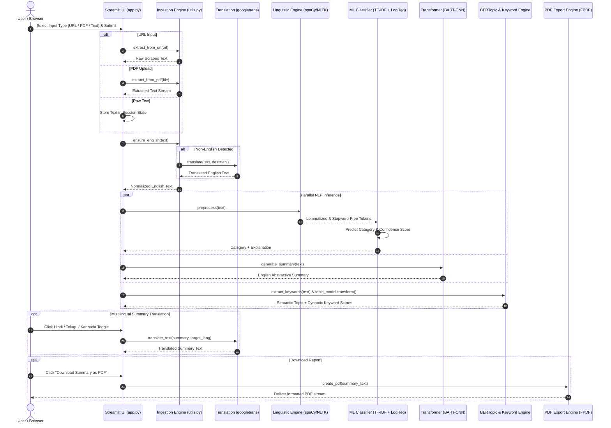

# System Architecture & Data Flow — NewsSense Platform

This document outlines the detailed system flow, data transformations, runtime state management, and interaction lifecycle of the **NewsSense** application.

---

## 1. High-Level End-to-End System Flow



---

## 2. Ingestion & Normalization Subsystem Flow

```
[User Input]
     │
     ├── (URL) ──> newspaper3k Article.download() + parse()
     ├── (PDF) ──> PyMuPDF fitz.open(stream) ──> page.get_text()
     └── (Text) ─> Direct String Input
     │
     ▼
[Raw String Buffer]
     │
     ▼
[Language Guardrail (langdetect.detect)]
     │
     ├── IF lang == 'en' ──> Pass through directly
     └── IF lang != 'en' ──> googletrans.Translator.translate(dest='en')
     │
     ▼
[Normalized English Corpus]
```

---

## 3. Linguistic & Feature Processing Pipeline

```
[Normalized English Corpus]
     │
     ▼
[spaCy en_core_web_sm Pipeline]
     ├── Lowercasing
     ├── Lemmatization (token.lemma_)
     ├── Stopword Removal (is_stop)
     ├── Punctuation Removal (is_punct)
     └── Numeric Token Filtering (like_num)
     │
     ▼
[Clean Preprocessed Token String]
     │
     ├───────────────────────────────────┐
     ▼                                   ▼
[TF-IDF Vectorizer (10k n-grams)]   [BERTopic Semantic Embeddings]
```

---

## 4. Multi-Model Inference Architecture

```
                  [Clean Preprocessed Token String]
                                  │
         ┌────────────────────────┼────────────────────────┐
         ▼                        ▼                        ▼
┌──────────────────┐    ┌──────────────────┐    ┌──────────────────┐
│ Category Engine  │    │ Summarizer Engine│    │ Topic & Keywords │
│                  │    │                  │    │                  │
│ TF-IDF Transform │    │ BART-large-CNN   │    │ 1. spaCy POS:    │
│ Logistic Regress │    │ Seq2Seq          │    │    NOUN/PROPN/ADJ│
│                  │    │                  │    │ 2. HDBSCAN Clust:│
│ Output:          │    │ Output:          │    │    Topic Weights │
│ Category + Prob  │    │ Abstractive      │    │ 3. Noise Filter: │
│ Guardrail:       │    │ Concise Summary  │    │    Remove 'said' │
│ If prob < 0.3:   │    │                  │    │ Output:          │
│   cat = 'others' │    │                  │    │ WordCloud Freqs  │
└────────┬─────────┘    └────────┬─────────┘    └────────┬─────────┘
         │                       │                       │
         └───────────────────────┼───────────────────────┘
                                 ▼
                     [Streamlit Session State]
                    • st.session_state['text']
                    • st.session_state['category']
                    • st.session_state['summary']
                    • st.session_state['keyword_scores']
```

---

## 5. UI State Management & Lifecycle Flow

Streamlit executes the script from top to bottom on every user interaction. To prevent redundant model recalculations:

1. **Input Submission Trigger**:
   - When the user clicks `Analyze URL`, `Analyze PDF`, or `Analyze Text`, text is stored in `st.session_state["text"]`.
2. **Inference Execution**:
   - If `text` is populated and results are not yet in state, the inference block executes once and updates session keys:
     - `st.session_state["summary"]`
     - `st.session_state["category"]`
     - `st.session_state["keyword_scores"]`
     - `st.session_state["current_lang"] = "en"`
3. **Language Switching**:
   - Clicking `Hindi`, `Telugu`, or `Kannada` only updates `st.session_state["current_lang"]` and displays pre-translated text without re-running classification or BART summarization.
4. **PDF Compilation**:
   - `create_pdf()` is executed on demand only when the user clicks the download button.

---

## 6. Error Handling & Failover Table

| Failure Scenario | Component | Handled Behavior | Recommended Production Fix |
| :--- | :--- | :--- | :--- |
| **Invalid or unreachable URL** | `newspaper3k` | Throws unhandled exception if site is down or 403 bot-blocked. | Add `try/except` with user-friendly alert and fallback to `trafilatura`. |
| **Out-of-domain / gibberish text** | `LogisticRegression` | Confidence score drops $< 0.30$; assigns category to `"others"`. | Calibrate probabilities with `CalibratedClassifierCV`. |
| **Outlier topic cluster** | `BERTopic` | Model assigns topic `-1`; code catches `-1` and calls `find_topics()` for closest semantic match. | Verified working fallback. |
| **Non-Latin characters in PDF** | `FPDF` | System scans for `DejaVu Sans` / `Segoe UI` TrueType fonts; falls back to ASCII normalization if missing. | Verified working fallback. |
| **Google Translate Rate Limit** | `googletrans` | Network exception caught; returns error string. | Implement exponential backoff retry. |
